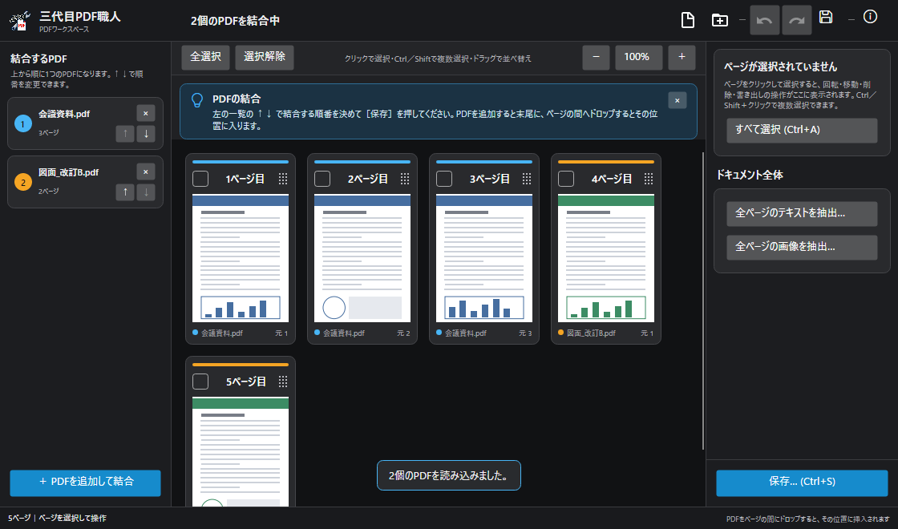

# 三代目PDF職人

PDFの結合・並べ替え・回転・ページの抜き出しなどを、まとめてこなすWindowsアプリです。
インストール不要の exe 1つで動き、ネットワークには接続しません。



WPF版で作っていたものを、.NET 10 と Avalonia で作り直しました。

## できること

- 複数のPDFを読み込んで結合（順番は ↑↓ で入れ替え）
- ページのサムネイル一覧で、並べ替え・回転・削除
- 別のPDFを、選んだページの前後に挿入
- 選んだページだけを新しいPDFとして保存
- テキストの抽出、埋め込み画像の抽出
- AES-256 のパスワードを付けて保存、パスワード付きPDFを開いて外す
- 元に戻す／やり直し（Ctrl+Z / Ctrl+Y）、最近使ったファイル
- ドラッグ＆ドロップ、exe にPDFを渡しての起動

## ダウンロード

[Releases](../../releases) から zip をダウンロードして展開し、中の `三代目PDF職人.exe` を好きなフォルダーに置いて起動してください。

- 動作環境: Windows 10 / 11（64ビット）。.NET のインストールは不要です
- 署名をしていないため、初回は「Windows によって PC が保護されました」と出ることがあります。「詳細情報」→「実行」で起動できます
- 初回起動時は、内蔵のライブラリを一時フォルダーへ展開するため少し時間がかかります

## 主なショートカット

| 操作 | キー |
| --- | --- |
| PDFを開く | Ctrl+O |
| 保存 | Ctrl+S |
| すべて選択／選択解除 | Ctrl+A ／ Esc |
| 右に回転／左に回転 | Ctrl+R ／ Ctrl+L |
| ページを前へ／後ろへ | Ctrl+← ／ Ctrl+→ |
| 選択ページを削除 | Delete |
| 元に戻す／やり直し | Ctrl+Z ／ Ctrl+Y |
| 拡大・縮小 | Ctrl+マウスホイール |

## プライバシーとアンインストール

- 実行時にネットワークへ接続しません。開いたPDFが外部へ送られることはありません
- 最近使ったファイルの一覧は `%LOCALAPPDATA%\PDF職人\settings.json` に保存されます
- アンインストールは exe を削除するだけです。上のフォルダーも消したい場合は手動で削除してください

## ビルド

.NET 10 SDK と Windows が必要です。

```powershell
.\build.ps1 -Action Build     # ビルド
.\build.ps1 -Action Test      # テスト
.\build.ps1 -Action Publish   # テストのあと、単一ファイルの exe を作る
```

`Publish` が成功すると `artifacts\publish\三代目PDF職人.exe` ができます。
.NET ランタイム、Avalonia、SkiaSharp、PDFium をすべて exe に含めています。

## 使っているライブラリ

[Avalonia](https://github.com/AvaloniaUI/Avalonia)、[PDFsharp](https://github.com/empira/PDFsharp)、[PdfPig](https://github.com/UglyToad/PdfPig)、[PDFtoImage](https://github.com/sungaila/PDFtoImage)（PDFium）ほか。
ライセンスは [THIRD-PARTY-NOTICES.txt](PdfSyokuninAvalonia/THIRD-PARTY-NOTICES.txt) を参照してください。

## ライセンス

[MIT License](LICENSE)
